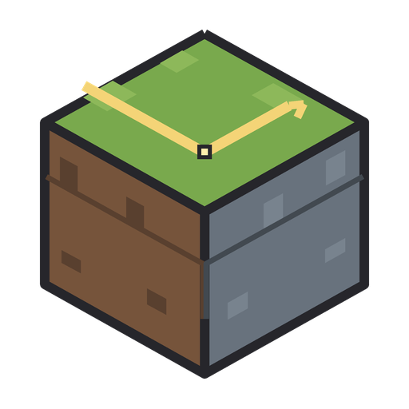

# Bedray

> **EARLY ALPHA — this is an evolving project, not a finished version. Major renderer, settings, configuration and compatibility changes are expected; bugs, crashes, visual artifacts and high GPU load are possible. Back up worlds/configuration and test in a separate instance. See the [roadmap](ROADMAP.md).**
> Tested only on an **NVIDIA GeForce RTX 5060 Ti (8 GB), Windows, NVIDIA driver 617.42**. Other graphics cards have not been checked.
> **Looking for testers with AMD Radeon (RDNA 2 or newer) and Intel Arc GPUs.** See [Help us test](#help-us-test).

> **Current `main`: unreleased 0.1.1-alpha.13 source integration (2026-10-26).** The development branches are consolidated here.
> No build, shader compilation, tests, game session or FPS measurement was run for this integration, at the owner's request.
> Earlier screenshots and release evidence describe earlier builds. See [the integration record](docs/DEVELOPMENT_BRANCHES.md).

Bedrock RTX-style ray tracing and path tracing for **Minecraft Java Edition**, running on the game's **native Vulkan backend**, as a
Sodium add-on with a dedicated Bedray settings screen opened from Video Settings. It also adds temporal upscalers
(DLSS, XeSS, FSR), denoisers and an experimental software voxel provider.

Bedray is **unofficial**. It is not affiliated with, endorsed by or sponsored by Mojang, Microsoft, NVIDIA, AMD or Intel.

## Screenshots

*Early alpha captures from one NVIDIA GeForce RTX 5060 Ti 8 GB system; they are not a quality or performance guarantee.* More images, modes and caveats: [docs/GALLERY.md](docs/GALLERY.md).

## What it does

* **Path Tracing:** global illumination with several bounces, accumulation, auto exposure and a denoiser
  (NRD, DLSS Ray Reconstruction, or accumulation only). Development settings provide renderer-specific quality profiles.
* **Ray Tracing effects (experimental):** traced sun/moon shadows, ambient occlusion, reflections and emissive block light.
  The published alpha.1 hid this mode; current source exposes experimental renderer choices in the Bedray screen.
* **Light shafts (volumetric light):** an option in the Basic group of the Ray Tracing page, next to bloom, sun glare and distance haze.
* **Materials:** LabPBR `_s` / `_n` maps, automatic PBR and normals for vanilla textures.
* **Water and glass:** realistic water uses approximate Snell refraction and medium segments; vanilla water keeps a textured
  sheet. Glass uses a thin tinted interface. RT camera and secondary walks use one query with up to 16 sorted layers;
  Path Tracing reuses sorted 16-entry batches across its existing 24-interface budget instead of restarting per glass face.
  Resource-pack optical profiles add IOR, authored thickness, RGB reference transmittance/distance and a diffuse coating.
  Direct/secondary transparent-shadow switches, conservative shared-face filtering and opt-in F3 counters are available.
  See [transparent materials](docs/TRANSPARENT_MATERIALS.md); this remains a slab approximation rather than closed-volume glass transport.
* **Iris post host (opt-in, experimental):** a Vulkan fullscreen post subset and custom RT hooks; general shaderpack compatibility
  remains incomplete. See [IRIS_VULKAN](docs/IRIS_VULKAN.md).
* **Upscalers:** DLSS Super Resolution, XeSS, FSR 3.1 / 2.x, plus built-in Bilinear, FSR 1 and NIS that need no extra files.
* **Frame generation:** NVIDIA DLSS frame generation (2x, 3x, 4x) and Reflex through Streamline. Needs extra files and one restart; tested only on an RTX 5060 Ti. See [docs/FRAME_GENERATION.md](docs/FRAME_GENERATION.md).

What works and how well it is proven is in **[docs/FEATURE_MATRIX.md](docs/FEATURE_MATRIX.md)**. Nothing in this alpha is marked stable.

Development alpha.13 includes **Voxel (Experimental)** in the Bedray player JAR. The provider keeps its own
mod ID and API, nested inside the loader artifact; do not install an additional external Compute JAR.
It uses ordinary Vulkan compute for textured block models, cutouts and bounded world lighting, with raster
preservation where representation is incomplete. Its requested coverage follows Minecraft render distance,
while actual residency is limited by scene memory and incremental loading. Full material/light transport,
multi-GPU performance and fresh live-game acceptance remain pending. See [COMPUTE](docs/COMPUTE.md).

## Requirements

| | |
|---|---|
| OS | Windows (the only tested platform) |
| GPU | Ray tracing needs `VK_KHR_ray_query` and acceleration structures: NVIDIA RTX, AMD RDNA 2 or newer, Intel Arc. **Tested only on RTX 5060 Ti.** |
| Driver | Vulkan 1.3 or 1.4 |
| Game | Minecraft 26.3 with the Vulkan graphics backend |
| Loader | NeoForge 26.3.0.x, or Fabric (fabric-loader 0.19.5 or newer). Fabric has less testing than NeoForge. |
| Required mods | Sodium 0.9.x (tested with 0.9.2). Bedray is a single jar; nothing else is needed |
| Java | 25 |

Bedray is client-side only and switches the game to the Vulkan backend in `options.txt`.

## Install

Short version (full guide: **[docs/INSTALL.md](docs/INSTALL.md)**):

1. Use a clean instance: Minecraft 26.3 with NeoForge or Fabric.
2. Put these files into `mods/`: Sodium 0.9.x and the Bedray jar for your loader (one jar, no extra library mod).
3. Start the game, open **Options, Video Settings → Bedray Settings** and choose the renderer. The development
   screen separates renderer, lighting, materials, upscaling, presets and diagnostics; pending changes require Apply.

The release jars include the exact redistributable AMD FidelityFX Vulkan runtime and Intel XeSS runtime, and extract them on first start.
Without extra files, the built-in upscalers (Bilinear, FSR 1, NIS), XeSS, FSR 3.1 and ray / path tracing with accumulation work.
DLSS, NRD, NVIDIA frame generation and Reflex need vendor files that are **not included**; download those from the vendor.
Do it by hand with [docs/INSTALL.md](docs/INSTALL.md), or let an AI assistant do the careful part with
[docs/INSTALL_NATIVES_WITH_AI.md](docs/INSTALL_NATIVES_WITH_AI.md).

## Documentation

| | |
|---|---|
| [INSTALL](docs/INSTALL.md) | Step by step, vendor libraries and where they go |
| [USER_GUIDE](docs/USER_GUIDE.md) | First start, modes, hotkeys, F3 information |
| [SETTINGS_REFERENCE](docs/SETTINGS_REFERENCE.md) | Every option, FPS cost, status |
| [UPSCALERS](docs/UPSCALERS.md) | Which upscaler to choose |
| [FRAME_GENERATION](docs/FRAME_GENERATION.md) | DLSS frame generation and Reflex |
| [TROUBLESHOOTING](docs/TROUBLESHOOTING.md), [FAQ](docs/FAQ.md), [KNOWN_ISSUES](docs/KNOWN_ISSUES.md) | When something is wrong |
| [ROADMAP](ROADMAP.md) | Long-term plan, priorities and acceptance gates |
| [SHADER_CACHE](docs/SHADER_CACHE.md) | SPIR-V warmup and Vulkan pipeline-cache behavior |
| [DXGI_PRESENT](docs/DXGI_PRESENT.md) | Minecraft's native DXGI presentation option and Bedray compatibility |
| [FEATURE_MATRIX](docs/FEATURE_MATRIX.md) | Status and evidence level of every feature |
| [TESTING](docs/TESTING.md) | How to test and report |
| [BUILDING](docs/BUILDING.md) | Build from source |

## Help us test

This alpha was developed and checked on **one** machine. Reports of any kind help:

* bugs and crashes, visual problems, performance numbers (FPS), screenshots,
* the result of a quick test on your GPU even if everything works.

How: open an issue with the **Bug report** or **GPU test report** form and paste the output of **`/bedray report`** (NeoForge) or of the
**Copy diagnostics report** button (Video Settings, page Advanced and Experimental, both loaders). The report is a plain text file in
`bedray/reports/` and is also copied to your clipboard. It holds only technical information: Bedray, Minecraft, loader and Sodium
versions, OS, CPU, GPU, driver, VRAM, Vulkan extensions, Bedray settings and status, average FPS and GPU times, counters, library file
names and the last warnings and errors of `latest.log`. Paths, your account name, the computer name, your player nick, UUIDs, e-mails
and IP addresses are replaced by `<redacted>`. **Nothing is sent over the network.** Please read it before you post it, and add a
screenshot if the problem is visual. See **[PRIVACY.md](PRIVACY.md)** and **[docs/TESTING.md](docs/TESTING.md)**.

**Looking for testers with AMD Radeon (RDNA 2+) and Intel Arc GPUs.** Bedray has not been run on these cards. What to check:
the game starts and the Bedray pages appear; Path Tracing can be switched on (ray query support); FSR 3.1 (AMD library
needed); XeSS (Intel library needed); Path Tracing with the NRD denoiser. The exact steps are in `docs/TESTING.md`.

## What is not included

* General Iris / "Dirt RT" shaderpack compatibility. The implemented opt-in post subset has explicit unsupported features.
* DLSS 5 / neural rendering: **not implemented**. The settings page shows a disabled line.
* AMD FSR frame generation, FSR 4 (not available on Vulkan).
* Complete particle transport in reflections and shadows; physical closed-volume refraction through glass.
* Linux and macOS.

## Licence

LGPL-3.0-or-later, see [LICENSE](LICENSE). Third-party code and licences: [THIRD_PARTY_NOTICES.md](THIRD_PARTY_NOTICES.md).
The source repository contains no vendor binaries. Release jars bundle only the unmodified AMD FidelityFX SDK v1.1.4 Vulkan DLL
and Intel XeSS SDK 3.0.2 DLL with their required notices; NVIDIA libraries and wrappers are not bundled.

Contributing: [CONTRIBUTING.md](CONTRIBUTING.md). Security: [SECURITY.md](SECURITY.md).
