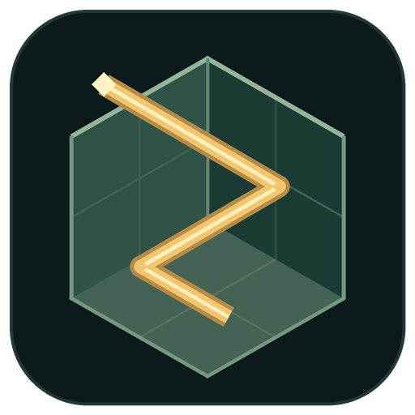
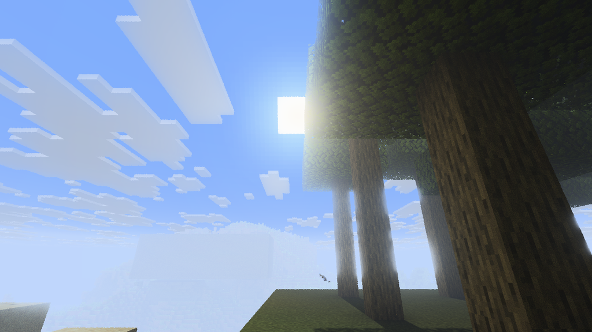
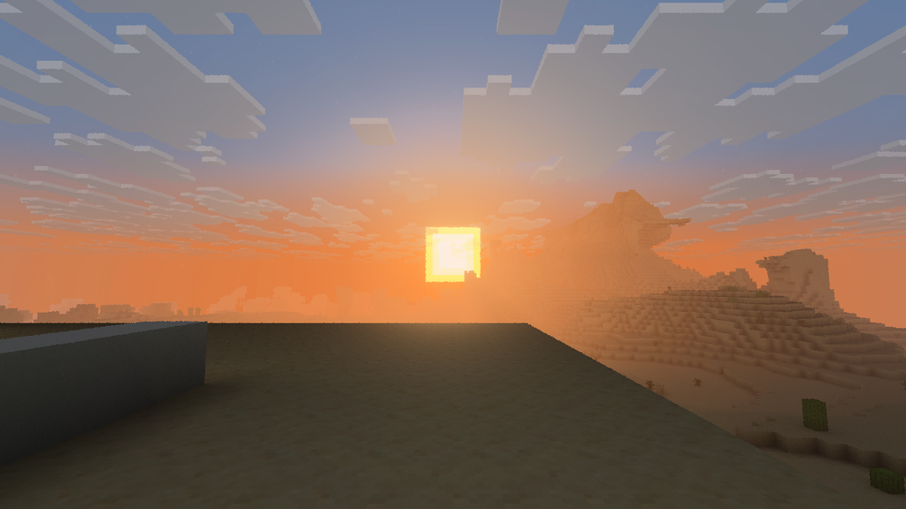
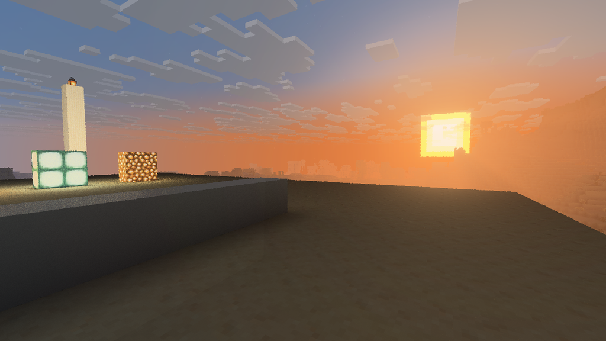
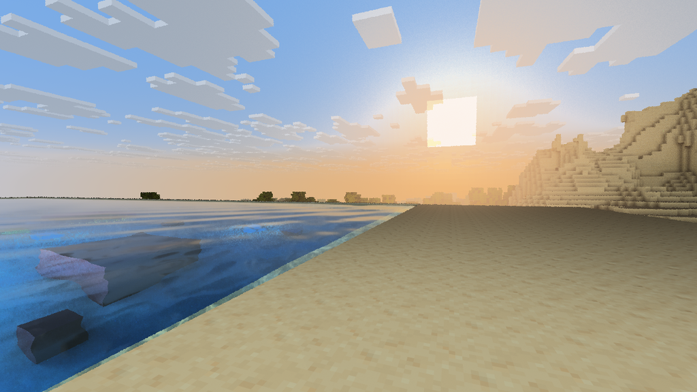

# Bedray

> **EARLY ALPHA — this is an evolving project, not a finished version. Major renderer, settings, configuration and compatibility changes are expected; bugs, crashes, visual artifacts and high GPU load are possible. Back up worlds/configuration and test in a separate instance. See the [roadmap](ROADMAP.md).**
> Tested only on an **NVIDIA GeForce RTX 5060 Ti (8 GB), Windows, NVIDIA driver 617.42**. Other graphics cards have not been checked.
> **Looking for testers with AMD Radeon (RDNA 2 or newer) and Intel Arc GPUs.** See [Help us test](#help-us-test).

> **Current `main` is the unreleased `0.2.0-alpha` source** (2026-11-13). It is a different renderer from the published
> pre-release [`0.1.0-alpha.1`](https://github.com/bnfe12/bedray/releases/tag/v0.1.0-alpha.1): shaders are Slang compiled ahead of
> time, and the scene, acceleration structures and frame graph live in a native C++ core (`bedray_core.dll`, ABI 3).
> The previous Java/GLSL renderer is kept in Git history (commit `9c985fa4`). `main` has **no published build yet**: build it
> yourself ([BUILDING](docs/BUILDING.md)). What is proven, at which level and on what, is in the
> [feature matrix](docs/FEATURE_MATRIX.md); measured costs are in the [GI stack report](docs/measurements/GI_STACK_REPORT.md).
> Build and CPU/native contract checks do **not** establish RTX visual quality or native 1080p/60 FPS.
> Branch rules: [BRANCH_LAYOUT](docs/BRANCH_LAYOUT.md). Remaining work: [STACK_IMPLEMENTATION_PLAN](docs/STACK_IMPLEMENTATION_PLAN.md).

Bedrock RTX-style ray tracing and path tracing for **Minecraft Java Edition**, running on the game's **native Vulkan backend**, as a
Sodium add-on with a dedicated Bedray settings screen opened from Video Settings. It also adds temporal upscalers
(DLSS, XeSS, FSR), denoisers and an experimental software voxel provider.

Bedray is **unofficial**. It is not affiliated with, endorsed by or sponsored by Mojang, Microsoft, NVIDIA, AMD or Intel.

## Screenshots (legacy)

> **Legacy captures.** These images come from early `0.1.0-alpha.x` builds of the previous (GLSL) renderer and are kept only as
> history. They do **not** show the current `main` renderer; they will be replaced by new captures made with a denoiser enabled.

*Early alpha captures from one NVIDIA GeForce RTX 5060 Ti 8 GB system; they are not a quality or performance guarantee.* All legacy images: [docs/GALLERY.md](docs/GALLERY.md).

## What it does

Everything below describes current `main`. Status words and evidence levels per feature: [FEATURE_MATRIX](docs/FEATURE_MATRIX.md).

* **Renderer core:** typed Slang passes compiled ahead of time to SPIR-V, a native scene/acceleration-structure/memory core,
  shared pipeline cache, bottom-level structure compaction (measured: render distance 32 fits in 4096 MiB of reserved
  acceleration-structure memory), regional top-level updates. See [ARCHITECTURE](docs/ARCHITECTURE_MANIFESTO.md) and [SLANG_MIGRATION](docs/SLANG_MIGRATION.md).
* **Path Tracing (main mode):** global illumination with several bounces, next-event estimation for emissive blocks, ReSTIR direct
  lighting and an opt-in ReSTIR path-tracing stage, Radiance Cascades field (opt-in), accumulation, auto exposure and HDR exposure,
  bloom and light shafts. Execution can use compute or ray-generation shaders; shader execution reordering is wired but measured
  slower on the test GPU, so it is off by default ([report](docs/measurements/GI_STACK_REPORT.md)).
* **Ray Tracing (Fast) and No-RT tiers (experimental / in development):** the ray profile and the voxel-based Tier 1 path exist in
  source; the AO and Direct modes are refused by name. The honest per-tier state is in [STACK_IMPLEMENTATION_PLAN](docs/STACK_IMPLEMENTATION_PLAN.md).
* **Denoisers:** NRD (REBLUR, ReLAX selectable) and DLSS Ray Reconstruction (render preset D/E/F hint, default off), with the primary-lobe
  signals split as described in [PRIMARY_DENOISER_SIGNALS](docs/ai-agent-addenda/PRIMARY_DENOISER_SIGNALS.md), or accumulation only.
* **Materials:** LabPBR `_s` / `_n` maps, automatic PBR and normals for vanilla textures, selective Nether and End bioluminescence,
  texture-style presets and an automatic settings policy.
* **Water and glass:** realistic water uses approximate Snell refraction and medium segments; vanilla water keeps a textured sheet.
  Glass is a thin tinted interface with Fresnel reflection; camera and secondary walks use one query with up to 16 sorted layers, and
  Path Tracing reuses sorted batches within its 24-interface budget. Resource-pack optical profiles add IOR, thickness and transmittance.
  See [TRANSPARENT_MATERIALS](docs/TRANSPARENT_MATERIALS.md); this remains a slab approximation, not closed-volume glass transport.
* **Iris / OptiFine shaderpacks (opt-in, experimental):** a Vulkan fullscreen post host and, new in `main`, a pack-level raster forward host
  (geometry captured from Sodium, pack gbuffers/shadow/composite/final recorded by Bedray, no OpenGL context, no runtime Iris). Unsupported
  required pack features are refused by name. General shaderpack compatibility is **not** claimed; see [IRIS_VULKAN](docs/IRIS_VULKAN.md).
* **Upscalers:** DLSS Super Resolution, XeSS, FSR 3.1 / 2.x, plus built-in Bilinear, FSR 1 and NIS that need no extra files.
* **Frame generation:** NVIDIA DLSS frame generation (2x, 3x, 4x) and Reflex through Streamline; needs extra files and one restart.
  See [FRAME_GENERATION](docs/FRAME_GENERATION.md).
* **Voxel (experimental):** a separately registered software voxel provider nested in the player jar (mod id `bedray_compute`); it uses ordinary
  Vulkan compute for textured block models, cutouts and bounded world lighting and keeps raster where its representation is incomplete.
  Do not install an extra Compute jar. See [COMPUTE](docs/COMPUTE.md).
* **Sodium integration:** a dedicated Bedray page inside Video Settings with pending changes, search and Apply/Revert. Sodium NeoForge
  0.9.2 through 0.9.3-beta.5 (seven official builds) are checked reproducibly at contract/compile level (L0/L1); see
  [`tools/sodium_compat_check.py`](tools/sodium_compat_check.py).

Nothing in this alpha is marked stable.

## Requirements

| | |
|---|---|
| OS | Windows (the only tested platform) |
| GPU | Ray tracing needs `VK_KHR_ray_query` and acceleration structures: NVIDIA RTX, AMD RDNA 2 or newer, Intel Arc. **Tested only on RTX 5060 Ti.** |
| Driver | Vulkan 1.3 or 1.4 |
| Game | Minecraft 26.3 with the Vulkan graphics backend |
| Loader | NeoForge 26.3.0.x, or Fabric (fabric-loader 0.19.5 or newer). Fabric has less testing than NeoForge. |
| Required mods | Sodium 0.9.x (tested with 0.9.2) and the Bedray JAR for your loader |
| Renderer library | Matching `bedray_core.dll` (native GPU scene and acceleration structures, ABI 3), built from `native/` |
| Java | 25 |

Bedray is client-side only and switches the game to the Vulkan backend in `options.txt`.

## Install

Short version (full guide: **[docs/INSTALL.md](docs/INSTALL.md)**):

1. Use a clean instance: Minecraft 26.3 with NeoForge or Fabric.
2. Put Sodium 0.9.x and the Bedray JAR for your loader into `mods/`.
3. Copy the matching `bedray_core.dll` into `bedray/natives/` in the same instance. The DLL includes the GPU scene.
4. Start the game, open **Options, Video Settings → Bedray Settings** and choose the renderer. The development
   screen separates renderer, lighting, materials, upscaling, presets and diagnostics; pending changes require Apply.

The release jars include the exact redistributable AMD FidelityFX Vulkan runtime and Intel XeSS runtime, and extract them on first start.
Ray tracing and path tracing with accumulation use the matching renderer core without a vendor denoiser.
DLSS, NRD, NVIDIA frame generation and Reflex need vendor files that are **not included**; download those from the vendor.
Do it by hand with [docs/INSTALL.md](docs/INSTALL.md), or let an AI assistant do the careful part with
[docs/INSTALL_NATIVES_WITH_AI.md](docs/INSTALL_NATIVES_WITH_AI.md).

## Documentation

Start with the [Bedray documentation site](https://bnfe12.github.io/bedray/) or browse the [full documentation index](docs/README.md).

| | |
|---|---|
| [INSTALL](docs/INSTALL.md) | Step by step, vendor libraries and where they go |
| [USER_GUIDE](docs/USER_GUIDE.md) | First start, modes, hotkeys, F3 information |
| [SETTINGS_REFERENCE](docs/SETTINGS_REFERENCE.md) | Every option, FPS cost, status |
| [UPSCALERS](docs/UPSCALERS.md) | Which upscaler to choose |
| [FRAME_GENERATION](docs/FRAME_GENERATION.md) | DLSS frame generation and Reflex |
| [DLSS 5 Neural Rendering](docs/experiments/dlss5.md) | Experimental Vulkan build and verification |
| [TROUBLESHOOTING](docs/TROUBLESHOOTING.md), [FAQ](docs/FAQ.md), [KNOWN_ISSUES](docs/KNOWN_ISSUES.md) | When something is wrong |
| [ROADMAP](ROADMAP.md) | Long-term plan, priorities and acceptance gates |
| [SHADER_CACHE](docs/SHADER_CACHE.md) | AOT SPIR-V and Vulkan pipeline-cache behavior |
| [DXGI_PRESENT](docs/DXGI_PRESENT.md) | Minecraft's native DXGI presentation option and Bedray compatibility |
| [FEATURE_MATRIX](docs/FEATURE_MATRIX.md) | Status and evidence level of every feature |
| [TESTING](docs/TESTING.md) | How to test and report |
| [BUILDING](docs/BUILDING.md) | Build from source, native core, CI |
| [CHANGELOG](CHANGELOG.md) | What changed, per version |
| [BRANCH_LAYOUT](docs/BRANCH_LAYOUT.md), [DEVELOPMENT_BRANCHES](docs/DEVELOPMENT_BRANCHES.md) | How `main` and branches are organised |
| [STACK_IMPLEMENTATION_PLAN](docs/STACK_IMPLEMENTATION_PLAN.md) | Remaining renderer work, per technology |
| [GI_STACK_REPORT](docs/measurements/GI_STACK_REPORT.md) | Measured GI / performance results with evidence levels |
| [IRIS_VULKAN](docs/IRIS_VULKAN.md) | Iris / OptiFine shaderpack host |
| [Documentation index](docs/README.md) | Every document, grouped |

## Help us test

Bedray was developed and checked on **one** machine. Reports of any kind help:

* bugs and crashes, visual problems, performance numbers (FPS), screenshots,
* the result of a quick test on your GPU even if everything works.

How: open an issue with the **Bug report** or **GPU test report** form and paste the output of **`/bedray report`** (NeoForge) or of the
**Copy diagnostics report** button (Video Settings, page Advanced and Experimental, both loaders). The report is a plain text file in
`bedray/reports/` and is also copied to your clipboard. It holds only technical information: Bedray, Minecraft, loader and Sodium
versions, OS, CPU, GPU, driver, VRAM, Vulkan extensions, Bedray settings and status, average FPS and GPU times, counters, library file
names and the last warnings and errors of `latest.log`. Paths, your account name, the computer name, your player nick, UUIDs, e-mails
and IP addresses are replaced by `<redacted>`. **Nothing is sent over the network.** Please read it before you post it, and add a
screenshot if the problem is visual. See **[PRIVACY.md](PRIVACY.md)** and **[docs/TESTING.md](docs/TESTING.md)**.

**Looking for testers with AMD Radeon (RDNA 2+) and Intel Arc GPUs.** Bedray has not been run on these cards. What to check:
the game starts and the Bedray pages appear; Path Tracing can be switched on (ray query support); FSR 3.1 (AMD library
needed); XeSS (Intel library needed); Path Tracing with the NRD denoiser. The exact steps are in `docs/TESTING.md`.

## What is not included

* General Iris / "Dirt RT" shaderpack compatibility. The implemented opt-in post subset has explicit unsupported features.
* DLSS Ray Reconstruction preset D/E/F A/B numbers, ReLAX-vs-REBLUR A/B numbers and isolated TLAS timing are not yet captured ([GI report](docs/measurements/GI_STACK_REPORT.md)).
* AMD FSR frame generation and [FSR 4 on Vulkan](https://gpuopen.com/amd-fsr-sdk/) are not integrated in Bedray.
* Complete particle transport in reflections and shadows; physical closed-volume refraction through glass.
* Linux and macOS.

## Licence

LGPL-3.0-or-later, see [LICENSE](LICENSE). Third-party code and licences: [THIRD_PARTY_NOTICES.md](THIRD_PARTY_NOTICES.md).
The source repository contains no vendor binaries. Release jars bundle only the unmodified AMD FidelityFX SDK v1.1.4 Vulkan DLL
and Intel XeSS SDK 3.0.2 DLL with their required notices; NVIDIA libraries and wrappers are not bundled.

Contributing: [CONTRIBUTING.md](CONTRIBUTING.md). Security: [SECURITY.md](SECURITY.md).
