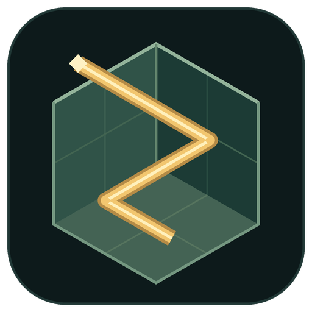

# Bedray brand assets

[Project home](../README.md) · [Documentation](README.md)

The mark connects two ideas: a block-built world and a ray that reflects inside it.
An open voxel makes the light path visible. Deep green surfaces and warm amber light
carry the same identity across the icon, README and shared links.

  

| Asset | Formats | Use |
| :--- | :--- | :--- |
| Logo | [SVG](images/bedray-logo.svg) · [PNG, 512 × 512](images/bedray-logo.png) | Mod icon and square placements |
| Banner | [SVG](images/bedray-banner.svg) · [PNG, 1280 × 400](images/bedray-banner.png) | Static project headers |
| Animated banner | [GIF, 1280 × 400](images/bedray-banner.gif) | README header; a slow, continuous light-path loop |
| Social preview | [PNG, 1280 × 640](images/bedray-social.png) | Repository link cards |

The animation is a brand illustration. It does not show gameplay or claim renderer quality or performance.
Use the static banner wherever motion is unnecessary. Keep the mark's proportions and give it space;
use the PNG when the destination does not accept SVG.

Assets are drawn from vector primitives by [`tools/make_brand_assets.py`](../tools/make_brand_assets.py).
To regenerate them, install Pillow and run `python tools/make_brand_assets.py` from the repository root.
The shared mod icon is generated from the same source.
