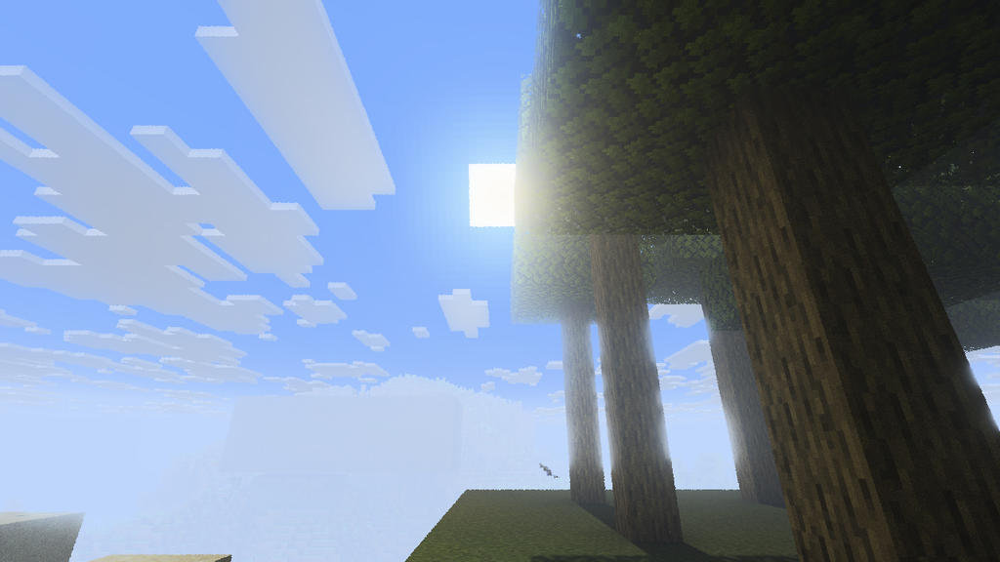
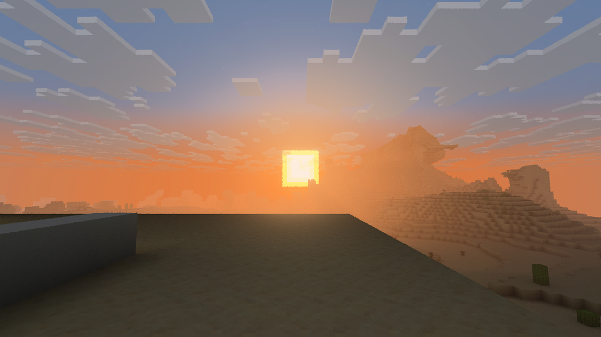
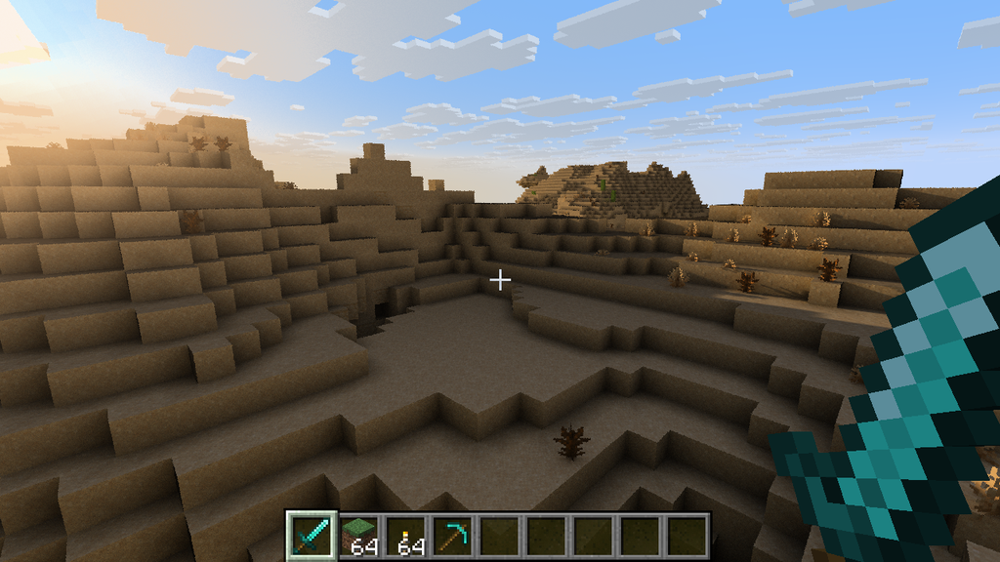
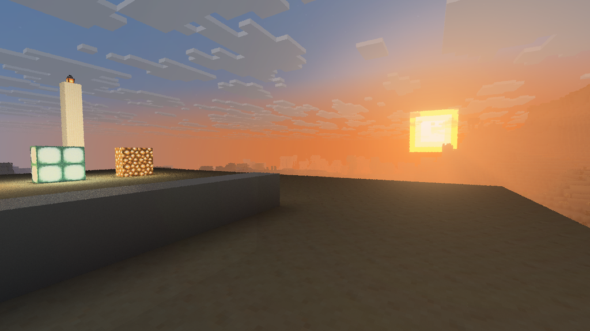
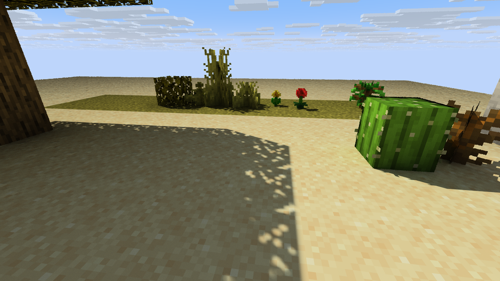
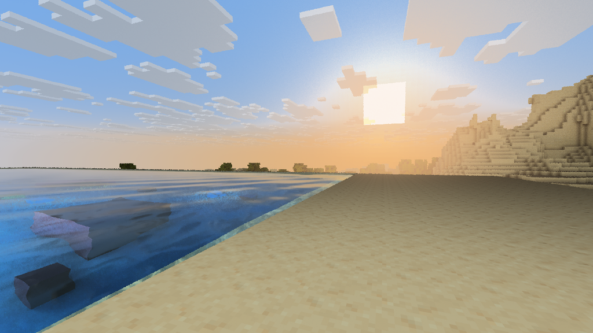

# Bedray gallery

These are early-alpha developer captures from one Windows system with an NVIDIA GeForce RTX 5060 Ti (8 GB). They show visual experiments, not a finished preset, benchmark or promise that every GPU will produce the same result. Current limitations are listed in [KNOWN_ISSUES](KNOWN_ISSUES.md), and per-feature evidence is in [FEATURE_MATRIX](FEATURE_MATRIX.md).

## Lighting previews

### Light shafts through a forest canopy

Light shafts are an optional atmosphere effect; their appearance and GPU cost are still being tuned.

### Path tracing at sunset

### Sunlight and block-shaped shadows

### Emissive blocks at sunset

Emissive lighting is experimental; the screenshot is a visual preview, not a claim of physically accurate light intensity.

### Leaf cutouts and shadows

## Water preview

Water currently uses a thin-surface approximation. Refraction and volumetric depth are not implemented, and reflections can be noisy or incomplete.

## Important alpha note

The images come from a single test GPU and do not demonstrate cross-vendor compatibility, stable performance, or that every optional denoiser/upscaler/frame-generation feature was enabled. See the [roadmap](../ROADMAP.md) for acceptance gates before those features can be considered complete.
