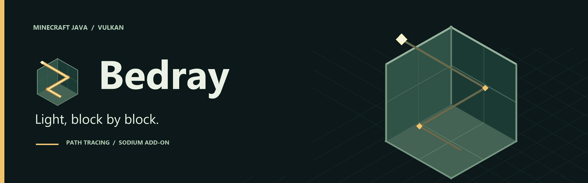

# Bedray documentation

<picture>
  <source media="(prefers-reduced-motion: reduce)" srcset="images/bedray-banner.png">
  
</picture>

[Project home](https://github.com/bnfe12/bedray/blob/main/README.md) · [Downloads](https://github.com/bnfe12/bedray/releases) · [Report an issue](https://github.com/bnfe12/bedray/issues/new/choose)

Start with the guide for your build. `main` is the unreleased `0.2.0-alpha` renderer;
the published `0.1.0-alpha.1` uses the earlier renderer and has its own release instructions.

## Play and configure

| Guide | What you will find |
| :--- | :--- |
| [Installation](INSTALL.md) | Requirements, loader setup, renderer core and optional libraries |
| [Runtime library downloads](RUNTIME_LIBRARIES.md) | Official sources, compatible packages and local import |
| [User guide](USER_GUIDE.md) | First start, renderer modes and diagnostics |
| [Settings reference](SETTINGS_REFERENCE.md) | Available controls and their trade-offs |
| [Upscalers](UPSCALERS.md) | Resolution scaling and hardware-dependent integrations |
| [Frame generation](FRAME_GENERATION.md) | Setup, requirements and limitations |
| [Experimental DLSS 5](experiments/dlss5.md) | Source-build setup and current validation limits |

## Get help

| Guide | What you will find |
| :--- | :--- |
| [Troubleshooting](TROUBLESHOOTING.md) | Startup, rendering and native-library problems |
| [Known issues](KNOWN_ISSUES.md) · [FAQ](FAQ.md) | Current limitations and common questions |
| [Testing and bug reports](TESTING.md) | Useful evidence and safe log sharing |
| [Privacy](https://github.com/bnfe12/bedray/blob/main/PRIVACY.md) · [Security](https://github.com/bnfe12/bedray/blob/main/SECURITY.md) | Diagnostics handling and vulnerability reporting |

## Follow the project

- [Roadmap](https://github.com/bnfe12/bedray/blob/main/ROADMAP.md) and [changelog](https://github.com/bnfe12/bedray/blob/main/CHANGELOG.md)
- [Feature status and evidence levels](FEATURE_MATRIX.md)
- [Legacy screenshot gallery](GALLERY.md) — captures of the earlier renderer
- [Brand assets](BRAND.md) — logo, banner and animation

<strong>For contributors: architecture, builds and measurements</strong>

### Build and validate

[Building](BUILDING.md) · [Contributing](https://github.com/bnfe12/bedray/blob/main/CONTRIBUTING.md) · [Branch layout](BRANCH_LAYOUT.md) · [Add-on settings API](ADDON_SETTINGS_API.md) ·
[Release checklist](RELEASE_CHECKLIST.md) · [Verification log](VERIFICATION_LOG.md)

[Native library licences and delivery](NATIVES_LICENSES.md)

### Renderer

[Architecture](ARCHITECTURE_MANIFESTO.md) · [Slang migration](SLANG_MIGRATION.md) ·
[Transparent materials](TRANSPARENT_MATERIALS.md) · [Shader cache](SHADER_CACHE.md) · [DXGI presentation](DXGI_PRESENT.md)

### Experimental integrations

[Iris shaderpacks](IRIS_VULKAN.md) · [Pack options](IRIS_OPTIONS.md) · [Custom RT shaders](CUSTOM_RT_SHADERS.md) ·
[Voxel provider](COMPUTE.md)

### Measurements and remaining work

[GI stack report](measurements/GI_STACK_REPORT.md) · [Reproduction guide](measurements/L5_REPRO.md) ·
[Native 1080p audit](NATIVE_1080P_60_AUDIT.md) · [Implementation plan](STACK_IMPLEMENTATION_PLAN.md)

